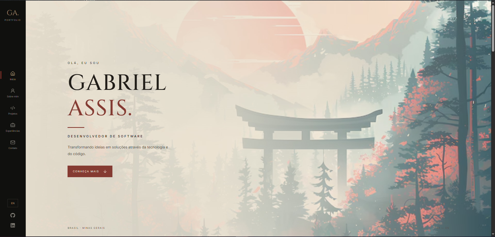
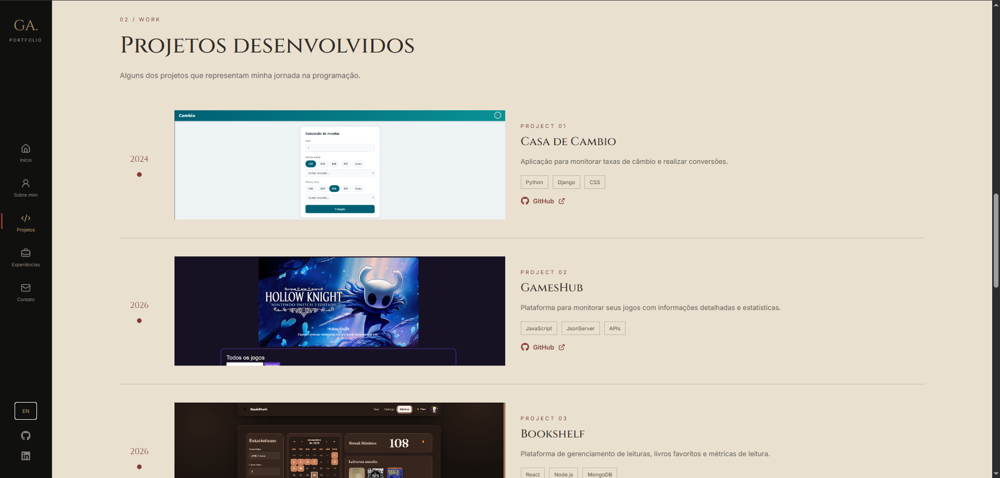
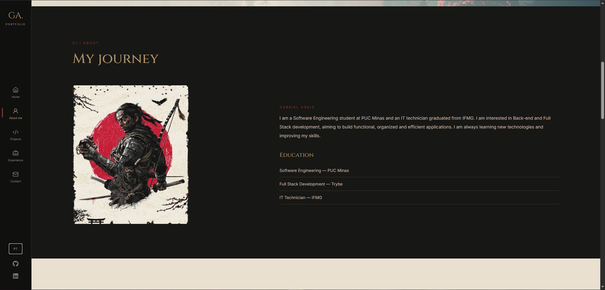

# 🏯 Gabriel Assis — Portfólio

> Portfólio pessoal desenvolvido para apresentar minha trajetória acadêmica, meus projetos e minhas habilidades na área de desenvolvimento de software.

---

## 🚧 Status do Projeto


---

## 📚 Índice

- [Links Úteis](#-links-úteis)
- [Sobre o Projeto](#-sobre-o-projeto)
- [Funcionalidades Principais](#-funcionalidades-principais)
- [Tecnologias Utilizadas](#-tecnologias-utilizadas)
- [Arquitetura](#-arquitetura)
- [Instalação e Execução](#-instalação-e-execução)
- [Deploy](#-deploy)
- [Estrutura de Pastas](#-estrutura-de-pastas)
- [Demonstração](#-demonstração)
- [Testes](#-testes)
- [Documentações Utilizadas](#-documentações-utilizadas)
- [Autor](#-autor)
- [Licença](#-licença)

---

## 🔗 Links Úteis

- 🌐 **Portfólio Online:** [Acessar portfólio](https://gabriel-assis.vercel.app/)
- 💻 **GitHub:** [Gabriel-Assis03](https://github.com/Gabriel-Assis03)
- 💼 **LinkedIn:** [Gabriel do Carmo Assis](https://linkedin.com/in/gabriel-do-carmo-assis)
- 📧 **E-mail:** [gabrielassis0709@gmail.com](mailto:gabrielassis0709@gmail.com)

---

## 📝 Sobre o Projeto

Este projeto consiste no desenvolvimento do meu portfólio pessoal, com o objetivo de apresentar minha trajetória na área de tecnologia, minha formação acadêmica, minhas habilidades e os projetos que desenvolvi durante meus estudos.

Atualmente, sou estudante de Engenharia de Software na PUC Minas, técnico em Informática pelo IFMG e formado no curso de Desenvolvimento de Software Full Stack da Trybe.

Tenho interesse principalmente no desenvolvimento Back-end, mas também busco aprimorar meus conhecimentos em desenvolvimento Full Stack.

O portfólio foi desenvolvido com uma identidade visual inspirada na estética japonesa tradicional, utilizando elementos visuais discretos para criar uma apresentação diferente, organizada e profissional.

A aplicação também conta com suporte aos idiomas português e inglês, permitindo que diferentes públicos conheçam meu trabalho.

---

## ✨ Funcionalidades Principais

- **Página Inicial:** apresentação pessoal e introdução ao portfólio.
- **Sobre Mim:** informações sobre minha trajetória, formação e interesses profissionais.
- **Projetos:** apresentação dos principais projetos desenvolvidos, incluindo descrições e tecnologias utilizadas.
- **Formação e Experiências:** organização da trajetória acadêmica e das experiências relevantes na área de tecnologia.
- **Contato:** disponibilização de canais para contato profissional.
- **Internacionalização:** alternância entre português e inglês.
- **Navegação entre Seções:** menu de navegação para acessar as diferentes partes do portfólio.
- **Responsividade:** adaptação da interface para diferentes tamanhos de tela.

---

## 🛠 Tecnologias Utilizadas

### 💻 Front-end

- **React:** construção da interface por meio de componentes reutilizáveis.
- **JavaScript (ES6+):** implementação da lógica e interatividade da aplicação.
- **HTML5:** estruturação do conteúdo.
- **CSS3:** estilização, responsividade e identidade visual.
- **Vite:** ferramenta de desenvolvimento e build da aplicação.

### 📦 Bibliotecas

- **Framer Motion:** animações e transições entre elementos.
- **Lucide React:** ícones utilizados na interface.
- **React Icons:** conjunto de ícones, incluindo marcas e redes sociais.

### ⚙️ Ferramentas e Hospedagem

- **Git:** controle de versão.
- **GitHub:** armazenamento e gerenciamento do código-fonte.
- **Vercel:** hospedagem da aplicação web.

---

## 🏗 Arquitetura

O projeto utiliza uma arquitetura baseada em componentes, organizada para facilitar a manutenção, reutilização de código e evolução da aplicação.

A interface foi dividida em componentes reutilizáveis e seções independentes, permitindo que cada parte do portfólio seja desenvolvida e modificada separadamente.

### Organização dos principais componentes

| Componente | Responsabilidade |
|---|---|
| `App.jsx` | Componente principal e organização das seções |
| `Sidebar.jsx` | Menu de navegação e alternância de idioma |
| `Home.jsx` | Apresentação inicial |
| `About.jsx` | Informações pessoais e formação |
| `Projects.jsx` | Exibição dos projetos |
| `Experience.jsx` | Formação e trajetória |
| `Contact.jsx` | Informações e formulário de contato |

### Fluxo da aplicação

1. O usuário acessa a página inicial.
2. O componente principal organiza e renderiza as seções do portfólio.
3. O menu lateral permite navegar entre as seções.
4. O estado de idioma controla a exibição dos textos em português ou inglês.
5. Os componentes apresentam as informações e os projetos cadastrados.

---

## 🔧 Instalação e Execução

### Pré-requisitos

Antes de executar o projeto, é necessário ter instalado:

- [Node.js](https://nodejs.org/) — versão LTS recomendada.
- npm — gerenciador de pacotes instalado junto ao Node.js.
- Git — para clonar o repositório.

### 1. Clonar o repositório

```bash
git clone https://github.com/Gabriel-Assis03/MyPortifolio
```

### 2. Acessar a pasta do projeto

```bash
cd portfolio
```

### 3. Instalar as dependências

```bash
npm install
```

### 4. Executar em ambiente de desenvolvimento

```bash
npm run dev
```

Após a inicialização, o Vite disponibilizará um endereço local, normalmente:

```text
http://localhost:5173
```

### 5. Gerar a versão de produção

Para gerar os arquivos otimizados da aplicação:

```bash
npm run build
```

Os arquivos serão gerados na pasta `dist`.

Para visualizar localmente a versão de produção:

```bash
npm run preview
```

---

## 🚀 Deploy

A aplicação utiliza a Vercel para hospedagem, por ser uma plataforma que oferece integração direta com repositórios GitHub e suporte ao Vite.

### Configurações de deploy

| Configuração | Valor |
|---|---|
| Plataforma | Vercel |
| Framework Preset | Vite |
| Build Command | `npm run build` |
| Output Directory | `dist` |
| Install Command | `npm install` |

### Processo de publicação

1. O código-fonte é enviado para um repositório no GitHub.
2. O repositório é conectado à plataforma Vercel.
3. A Vercel instala as dependências e executa o processo de build.
4. Os arquivos gerados são publicados e disponibilizados por meio de uma URL pública.

**Link da aplicação publicada:** [Acessar portfólio](https://gabriel-assis.vercel.app/)

---

## 📂 Estrutura de Pastas

A aplicação está organizada da seguinte maneira:

```text
portfolio/
│
├── public/
│   └── images/
│       ├── hero-japan.jpg
│       ├── about.jpg
│       └── projects/
│           ├── cambio.png
│           ├── bookshelf.png
│           └── gamesHub.png
│
├── src/
│   │
│   ├── components/
│   │   ├── Sidebar.jsx
│   │
│   ├── sections/
│   │   ├── Home.jsx
│   │   ├── About.jsx
│   │   ├── Projects.jsx
│   │   ├── Experience.jsx
│   │   └── Contact.jsx
│   │
│   ├── translations/
│   │   └── translations.js
│   │
│   ├── styles/
│   │   └── global.css
│   │
│   ├── App.jsx
│   └── main.jsx
│
├── .gitignore
├── index.html
├── package.json
├── package-lock.json
├── vite.config.js
└── README.md
```

**Descrição das pastas:**

- `public/images`: imagens utilizadas no portfólio e nas demonstrações dos projetos.
- `src/components`: componentes reutilizáveis da interface.
- `src/sections`: seções principais da aplicação.
- `src/translations`: textos e conteúdos dos idiomas disponíveis.
- `src/styles`: estilos globais e identidade visual.
- `App.jsx`: organização geral da aplicação.
- `main.jsx`: ponto de entrada do React.

---

## 🎥 Demonstração

Esta seção apresenta algumas telas e funcionalidades do portfólio.

### Página Inicial



### Projetos



### Navegação e alternância de idioma




---

## 🧪 Testes

Durante o desenvolvimento, as funcionalidades da aplicação podem ser verificadas por meio de testes manuais no navegador.

Os principais pontos de validação são:

- Navegação entre todas as seções.
- Funcionamento da alternância entre português e inglês.
- Exibição correta dos projetos e suas informações.
- Funcionamento dos links externos e canais de contato.
- Adaptação da interface para diferentes resoluções de tela.
- Verificação de erros no console do navegador.

---

## 🔗 Documentações Utilizadas

- [Documentação Oficial do React](https://react.dev/)
- [Documentação do Vite](https://vite.dev/)
- [Documentação do Framer Motion](https://motion.dev/)
- [Documentação do Lucide React](https://lucide.dev/)
- [Documentação do React Icons](https://react-icons.github.io/react-icons/)
- [Documentação da Vercel](https://vercel.com/docs)
- [Documentação do Git](https://git-scm.com/doc)

---

## 👤 Autor

**Gabriel do Carmo Assis**

Estudante de Engenharia de Software na PUC Minas, técnico em Informática pelo IFMG e desenvolvedor Full Stack em formação.

Tenho interesse em desenvolvimento de software, principalmente na área Back-end, e estou sempre buscando aprender novas tecnologias e desenvolver projetos que contribuam para minha evolução profissional.

| Contato | Link |
|---|---|
| GitHub | [Gabriel-Assis03](https://github.com/Gabriel-Assis03) |
| LinkedIn | [Gabriel do Carmo Assis](https://linkedin.com/in/gabriel-do-carmo-assis) |
| E-mail | [gabrielassis0709@gmail.com](mailto:gabrielassis0709@gmail.com) |

---

## 📄 Licença

Este projeto está disponível sob a licença MIT. Consulte o arquivo `LICENSE` para mais informações.
